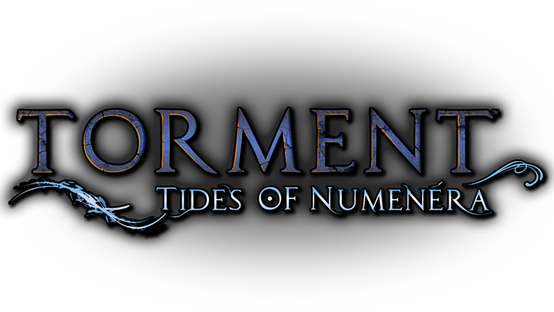

# Torment: Tides of Numenera - Text Overhaul

This mod revises narration and descriptive text throughout the game while preserving character dialogue and voiced narration. The original writing is incredibly dense, wordy, and often overwritten. The aim is to trim unnecessary prose and make reading less of a slog without losing the game's atmosphere. The game itself isn't bad; the writers just didn't know when to stop. Sometimes less is more, and RPG writing is no exception.

Only english text has been touched. Voiced lines are unchanged, as well as regular dialog spoken by characters. 

To install the files, go to your installation directory and override the TidesOfNumenera_Data folder with all new files. After restarting the game, the new text is applied.
